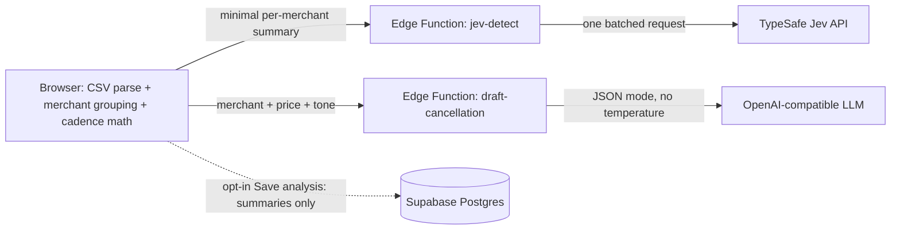

# Subscription Detective

Import a bank or card statement CSV and find every recurring subscription hiding in it: streaming, software, AI tools, gyms, news. The app shows monthly and annual cost, flags price hikes and free trials that quietly converted, and drafts cancellation emails you can copy. Nothing is ever sent.

**All sample data is fictional.** Every merchant, amount, and account in the bundled sample CSV is invented.

## Overview

- CSV is parsed entirely in your browser (Papa Parse). The raw file never leaves your machine.
- Merchants are grouped and cadence is measured in code (median interval, spread, amount stability).
- One batched Jev ("System One") request answers one yes/no question per merchant: *Is this a recurring subscription?*
- All money math - totals, monthly equivalents, price hikes, trial conversions, next renewals - is computed in code. The LLM never does date math.
- The LLM only writes cancellation email drafts as text. Copy or download; the app never sends email.

## Architecture



## Privacy

- The CSV is parsed entirely in the browser. The raw file and raw rows are never uploaded or stored on a server.
- Only a minimal per-merchant summary (cleaned merchant name, charge dates, amounts, code-computed cadence facts) is sent to the `jev-detect` Edge Function. Account numbers, balances, card digits, and memos are dropped before anything leaves the browser.
- Analyses live in localStorage by default. **Save analysis** (opt-in) stores only merchant summaries and results in Supabase. **Clear all data** wipes both.
- Subscription Detective never sends email. Drafts are text you copy into your own mail app.

## Modes

- **Jev mode** - Live / Replay. Replay (automatic when `TYPESAFE_API_KEY` is missing) works only for the bundled sample CSV, using recorded answers in `public/sample/recorded-jev.json`. Replay results carry a visible "Replay: recorded Jev answers" badge and are never presented as live. A custom CSV in Replay mode falls back to a labeled **Heuristic (not Jev)** classifier (cadence + amount stability).
- **LLM mode** - Live / Mock. Mock (automatic when `OPENAI_API_KEY` is missing) builds drafts from templates.
- With no secrets set, the sample runs end to end (Replay + Mock).
- Each Edge Function is capped at 200 calls per day; the UI then switches to Replay so the demo keeps working.

## Setup

```bash
# secrets (server-side only, never in the browser)
supabase secrets set TYPESAFE_API_KEY=sk-...
supabase secrets set OPENAI_API_KEY=sk-...
supabase secrets set OPENAI_MODEL=gpt-6-luna
supabase secrets set OPENAI_BASE_URL=https://api.openai.com/v1

# deploy
supabase functions deploy jev-detect
supabase functions deploy draft-cancellation
supabase db push   # run migrations

npm install
npm run dev        # the sample works with no secrets (Replay + Mock)
```

## Environment variables

| Name | Required | Default | Scope |
| --- | --- | --- | --- |
| `TYPESAFE_API_KEY` | for live Jev | - | server-side secret (Edge Function) |
| `OPENAI_API_KEY` | for live drafts | - | server-side secret (Edge Function) |
| `OPENAI_MODEL` | no | `gpt-6-luna` | server-side secret (Edge Function) |
| `OPENAI_BASE_URL` | no | `https://api.openai.com/v1` | server-side secret (Edge Function) |
| `VITE_SUPABASE_URL` | yes | pre-provisioned | public (browser bundle) |
| `VITE_SUPABASE_ANON_KEY` | yes | pre-provisioned | public (browser bundle) |

Never put an API key in client code, the sample CSV, fixtures, or committed `.env` files. Use placeholders like `sk-...` in docs.

## Screenshots


## Design decisions

- **One batched Jev request with one Noul per merchant** instead of N calls: Jev answers many questions in a single request, so all candidate merchants (2+ charges, or a single trial/renewal-looking charge) go out together with neutral question IDs (`m01`, `m02`, ...). Chunking happens only when the request would be too large (60 merchants or ~20k state tokens; limits 64k per request, 32k for state plus the longest question).
- **Cadence, totals, price hikes, and trials are computed in code** because Jev is weak at math and dates: interval medians, monthly equivalents (weekly x 52/12, biweekly x 26/12, quarterly / 3, annual / 12), the persisting >= 1% and >= $0.50 hike rule, and the $0-to-full-price-in-6-32-days trial rule all live in pure TypeScript.
- **The LLM writes drafts but never decides or sends**: classification is Jev + code policy; drafts are text only, with no send button, SMTP, email API, or mailto link.
- **No temperature parameter** is ever sent to OpenAI (`gpt-6-luna` rejects it). Chat requests send only `model`, `messages`, and `response_format: { "type": "json_object" }`.
- **Labeled Replay fixtures and heuristic fallback**: recorded answers are keyed to a hash of the merchant summaries, so Replay only applies when the input matches, and heuristic results are always labeled "Heuristic (not Jev)".
- **Integer cents everywhere**: money is stored as integer cents and formatted with `Intl.NumberFormat`.
